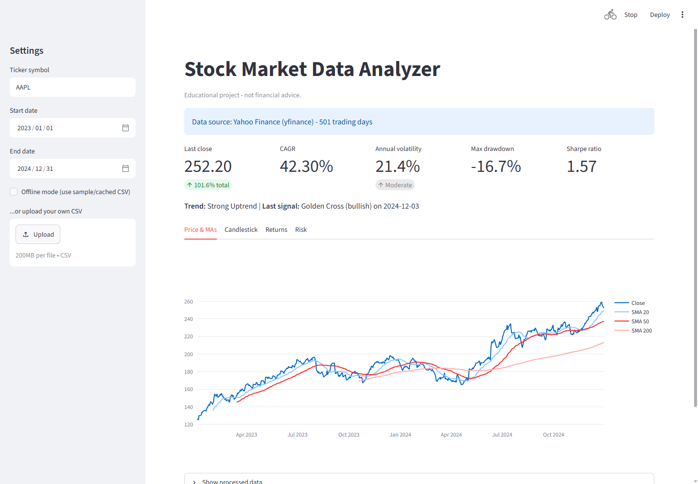
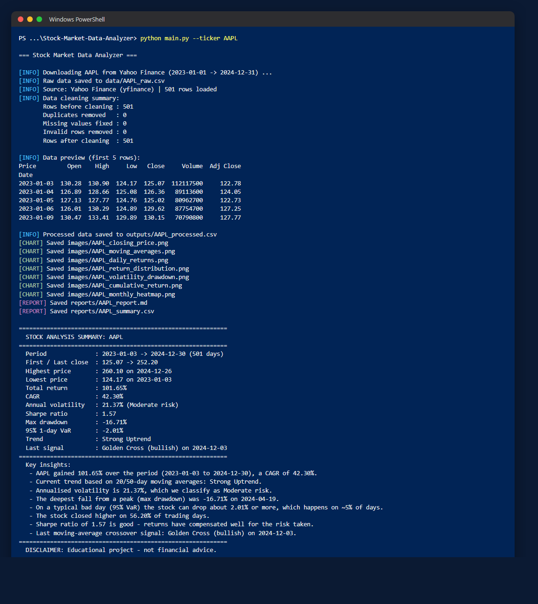
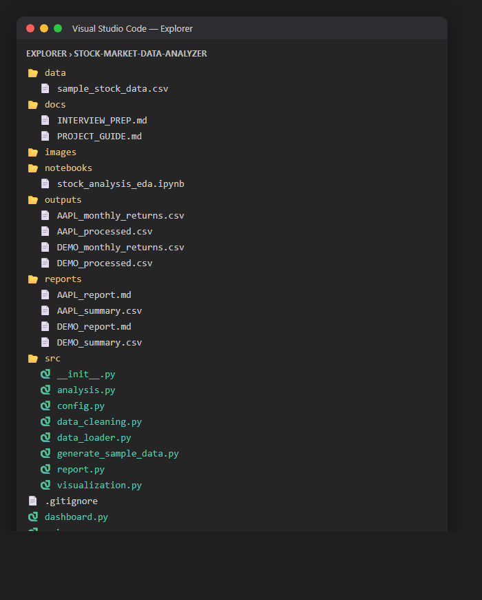
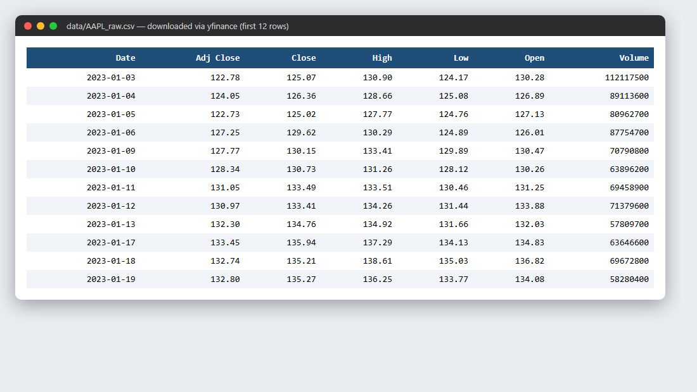
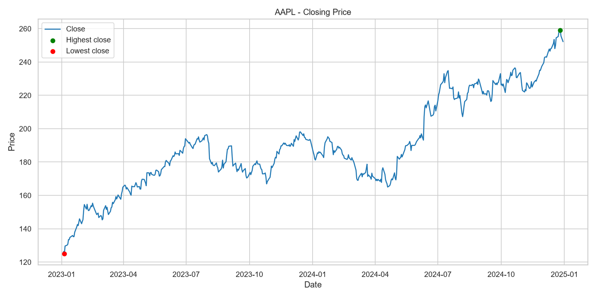
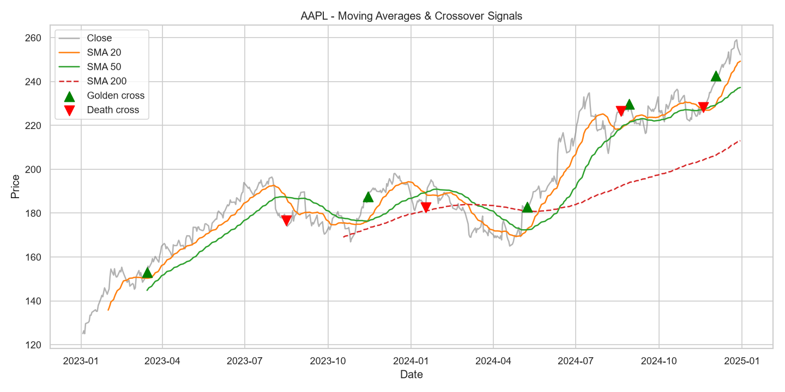
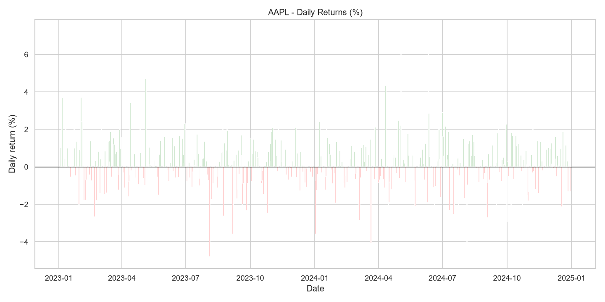
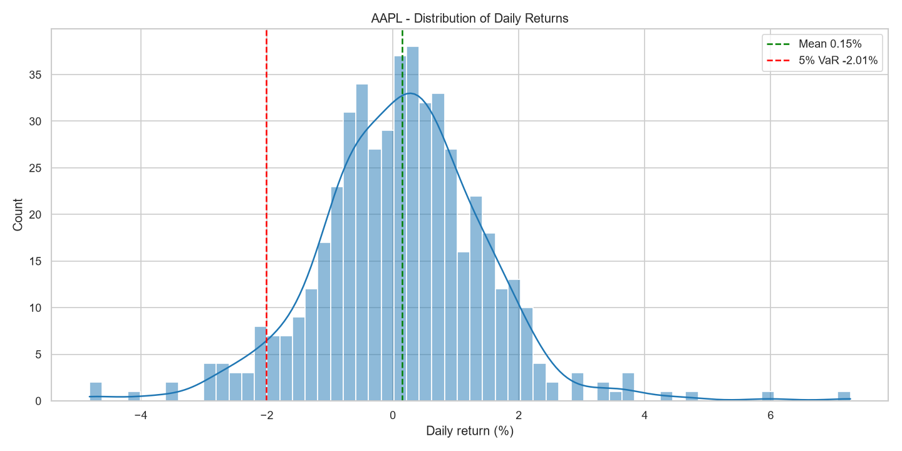
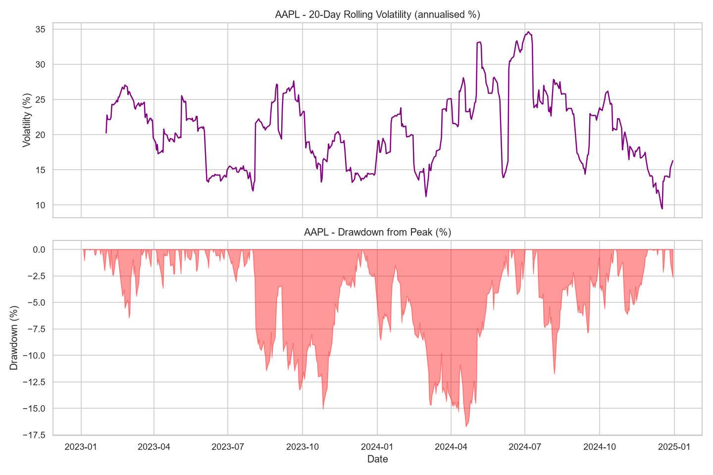
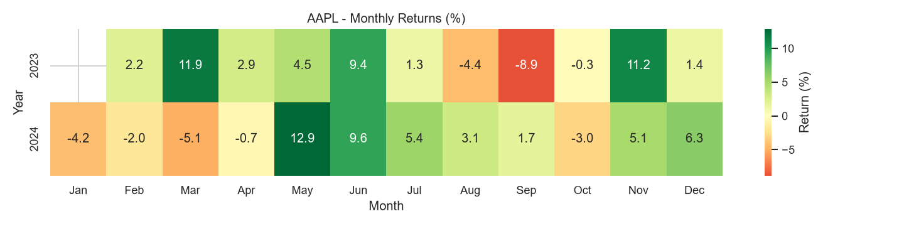

# 📈 Stock Market Data Analyzer

A modular Python tool that collects historical stock prices (Yahoo Finance or CSV), cleans the data, measures **returns, trend and risk**, saves **7 charts**, and writes an **automated analysis report**. It also includes an optional **Streamlit dashboard**.

> ⚠️ **Disclaimer:** This project is for **educational purposes only**. It is **not financial advice**. Do not make investment decisions based on its output.

---

## 🧩 Problem Statement
Retail investors and students often look at a stock chart and "feel" whether it is going up or is risky. Professional analysts instead **measure** it: how much did it return, how volatile is it, how deep were its falls, and what does the trend say? Doing this by hand in Excel for every stock is slow and error-prone.

**This project automates that workflow**: give it a ticker and a date range, and it produces a repeatable, data-driven analysis in seconds.

## 🏢 Industry Relevance
| Who | How they use this kind of analysis |
|---|---|
| Equity research analysts | Price history, return & risk metrics for research notes |
| Portfolio / risk teams | Volatility, drawdown and Value-at-Risk monitoring |
| Traders | Moving-average crossovers as trend signals |
| FinTech apps (Zerodha, Groww, Robinhood) | The same metrics shown on stock pages and dashboards |
| Business / data analysts | Automated data pipelines and reporting |

## ✨ Features
- **Data collection** from Yahoo Finance via `yfinance` (US, Indian `.NS`/`.BO`, and global tickers)
- **Automatic CSV fallback** – cached data or a bundled sample dataset, so it runs **offline**
- **Data cleaning** – duplicates, missing values, wrong types, invalid prices (with a cleaning log)
- **Return analysis** – daily, cumulative, log returns, CAGR, best/worst day, monthly returns
- **Trend analysis** – SMA 20/50/200, EMA 20, golden-cross / death-cross signals, trend label
- **Risk analysis** – rolling & annualised volatility, max drawdown, Sharpe ratio, 95% VaR
- **7 charts** saved as PNG (price, moving averages, daily returns, distribution, volatility/drawdown, cumulative return, monthly heatmap)
- **Reports** – Markdown report with plain-English insights + summary CSV
- **Interactive dashboard** (Streamlit + Plotly) with candlestick chart and CSV upload
- **Jupyter notebook** for step-by-step exploration

## 🛠 Tech Stack
`Python 3.10+` · `pandas` · `NumPy` · `Matplotlib` · `Seaborn` · `yfinance` · `Plotly` · `Streamlit` · `Jupyter`

## 📁 Folder Structure
```
Stock-Market-Data-Analyzer/
├── data/                  # input data (sample CSV + cached downloads)
├── notebooks/             # Jupyter notebook for EDA
├── src/                   # source code (one module per pipeline step)
│   ├── config.py          #   settings: paths, windows, risk-free rate
│   ├── data_loader.py     #   yfinance download + CSV fallback
│   ├── data_cleaning.py   #   cleaning & validation
│   ├── analysis.py        #   returns, moving averages, volatility, summary
│   ├── visualization.py   #   all charts
│   ├── report.py          #   insights + Markdown/CSV report
│   └── generate_sample_data.py  # creates the synthetic offline dataset
├── outputs/               # processed CSVs (all calculated columns)
├── images/                # saved charts (PNG)
├── reports/               # generated reports (.md / .csv)
├── docs/                  # project guide + interview preparation
├── main.py                # command-line entry point (runs the full pipeline)
├── dashboard.py           # optional Streamlit dashboard
├── requirements.txt
└── .gitignore
```

## 🔄 Workflow
```
Ticker + dates ─► Collect data ─► Clean ─► Returns ─► Moving averages ─► Volatility & risk ─► Charts ─► Report
                 (yfinance/CSV)
```

## 🚀 How to Run
```bash
# 1. Clone and enter the project
git clone https://github.com/SNischayPrasad/Stock-Market-Data-Analyzer.git
cd Stock-Market-Data-Analyzer

# 2. Create & activate a virtual environment
python -m venv venv
venv\Scripts\activate          # Windows
source venv/bin/activate       # Mac / Linux

# 3. Install dependencies
pip install -r requirements.txt

# 4. Run the analyzer
python main.py                                         # AAPL 2023-2024
python main.py --ticker MSFT --start 2022-01-01 --end 2024-12-31
python main.py --ticker TCS.NS                         # Indian stock (NSE)
python main.py --offline                               # no internet: uses sample CSV
python main.py --csv data/sample_stock_data.csv --ticker DEMO

# 5. (Optional) Launch the dashboard
streamlit run dashboard.py
```

## 📊 Sample Output (AAPL, 2023-01-01 → 2024-12-31)
```
============================================================
  STOCK ANALYSIS SUMMARY: AAPL
============================================================
  Period              : 2023-01-03 -> 2024-12-30 (501 days)
  First / Last close  : 125.07 -> 252.20
  Highest price       : 260.10 on 2024-12-26
  Lowest price        : 124.17 on 2023-01-03
  Total return        : 101.65%
  CAGR                : 42.30%
  Annual volatility   : 21.37% (Moderate risk)
  Sharpe ratio        : 1.57
  Max drawdown        : -16.71%
  95% 1-day VaR       : -2.01%
  Trend               : Strong Uptrend
  Last signal         : Golden Cross (bullish) on 2024-12-03
============================================================
```
Full report: [`reports/AAPL_report.md`](reports/AAPL_report.md)

## 🖼 Screenshots
### Interactive dashboard (Streamlit)


### Terminal output


| Project structure | Dataset preview |
|---|---|
|  |  |

### Charts
| Closing price | Moving averages & signals |
|---|---|
|  |  |
| **Daily returns** | **Return distribution** |
|  |  |
| **Volatility & drawdown** | **Monthly returns heatmap** |
|  |  |

## 📐 Key Formulas
| Metric | Formula |
|---|---|
| Daily return | `Close_t / Close_(t-1) − 1` |
| Cumulative return | `∏(1 + r_t) − 1` |
| CAGR | `(End / Start)^(1/years) − 1` |
| SMA (N) | mean of last N closes |
| Annualised volatility | `std(daily returns) × √252` |
| Sharpe ratio | `(annual return − risk-free rate) / annual volatility` |
| Max drawdown | `min(Close / running max − 1)` |
| 95% VaR (historical) | 5th percentile of daily returns |

## 🎓 Learning Outcomes
- Fetching real financial data from an API and handling failures gracefully
- Cleaning time-series data with pandas (`ffill`, de-duplication, type coercion)
- Rolling-window calculations (`rolling`, `ewm`, `pct_change`, `cummax`, `resample`)
- Core finance concepts: returns, CAGR, volatility, Sharpe, drawdown, VaR, MA crossovers
- Data visualization with Matplotlib/Seaborn and interactive Plotly/Streamlit
- Writing modular, reusable, documented Python and a CLI with `argparse`
- Automating report generation and publishing a project on GitHub

## 🔮 Future Improvements
- Compare multiple stocks / benchmark against an index (NIFTY 50, S&P 500)
- More indicators: RSI, MACD, Bollinger Bands
- Backtest the moving-average crossover strategy
- Unit tests with `pytest` and GitHub Actions CI
- Deploy the dashboard on Streamlit Community Cloud

## 📚 Documentation
- [`docs/PROJECT_GUIDE.md`](docs/PROJECT_GUIDE.md) – full explanation, architecture, phase plan, simulation, GitHub steps, proof plan
- [`docs/INTERVIEW_PREP.md`](docs/INTERVIEW_PREP.md) – interview questions with answers
- [`docs/SOCIAL_POSTS.md`](docs/SOCIAL_POSTS.md) – LinkedIn & Instagram posts (slides in `images/social/`)

## ⚠️ Disclaimer
This project is created **for educational and learning purposes only**. It is **not financial, investment or trading advice**. Stock market investments are subject to market risk; past performance does not guarantee future results. Always consult a SEBI-registered / licensed financial advisor before investing. The bundled `sample_stock_data.csv` is **synthetic** data and does not represent any real company.

## 👤 Author
**Your Name** · [LinkedIn](https://linkedin.com/in/your-profile) · [GitHub](https://github.com/SNischayPrasad)
