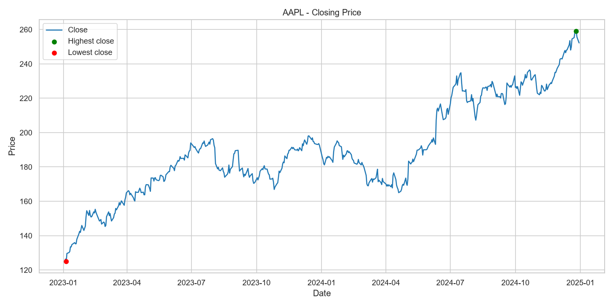
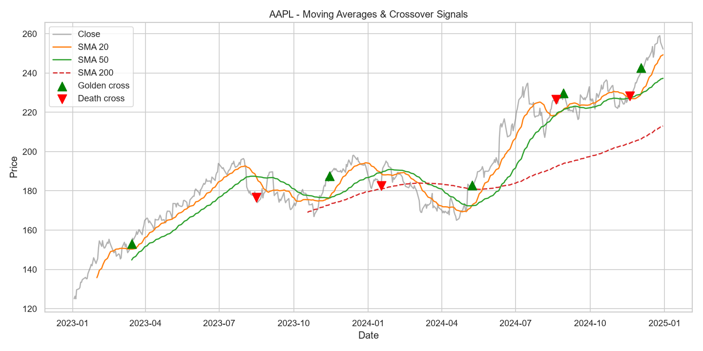
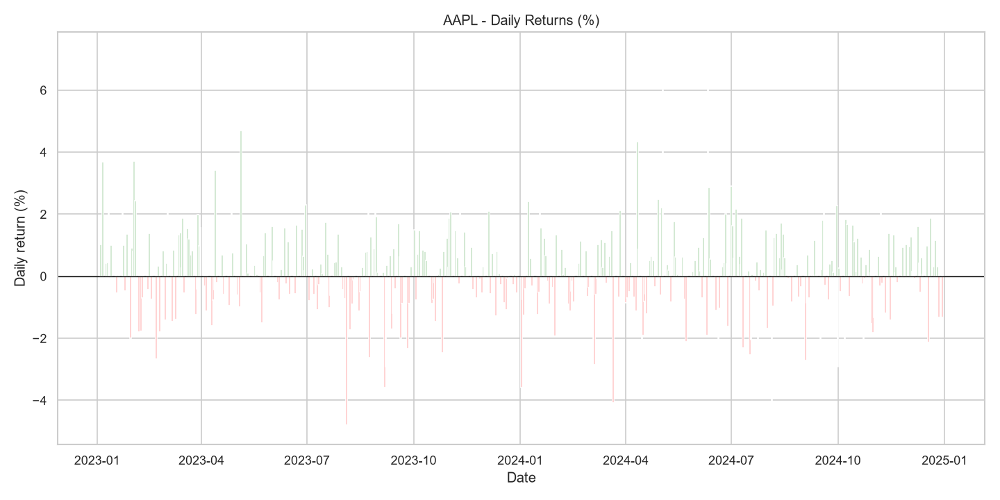
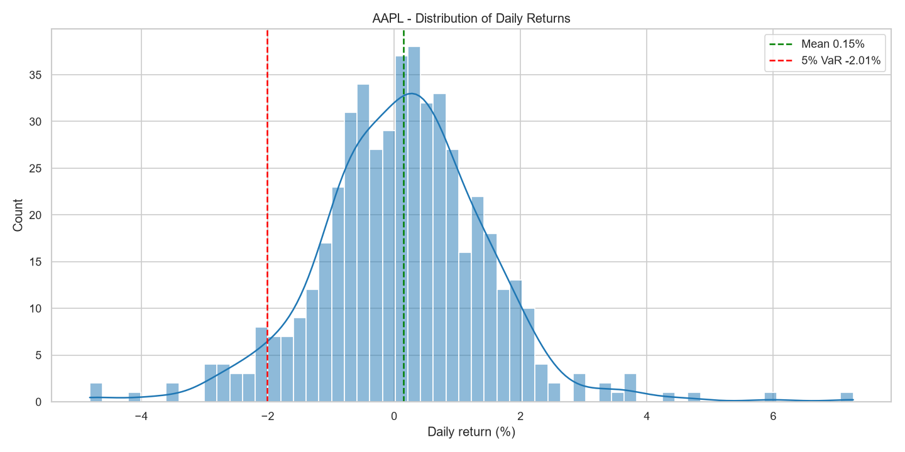
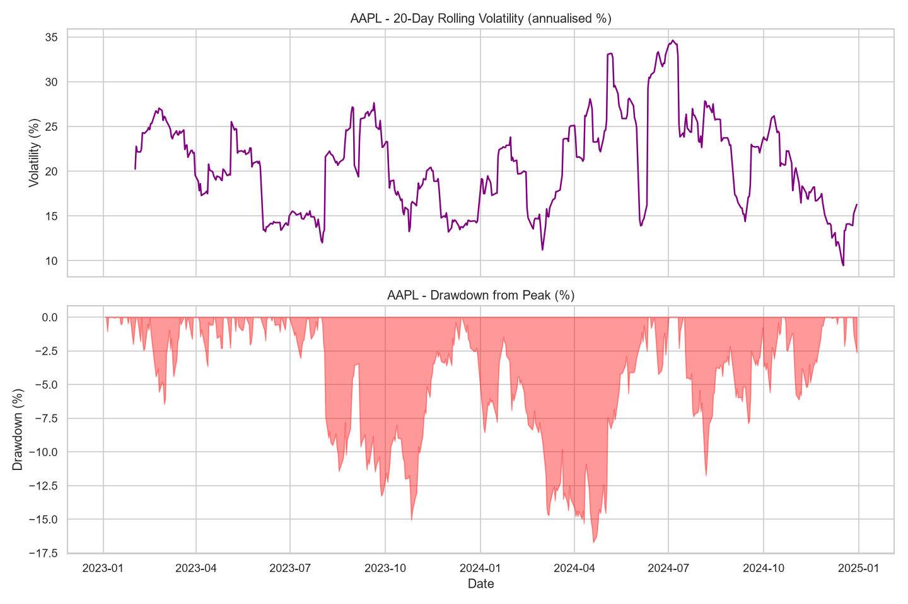
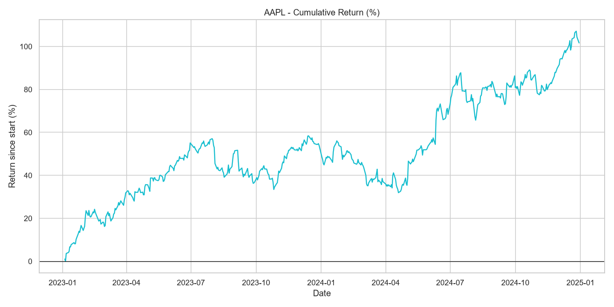
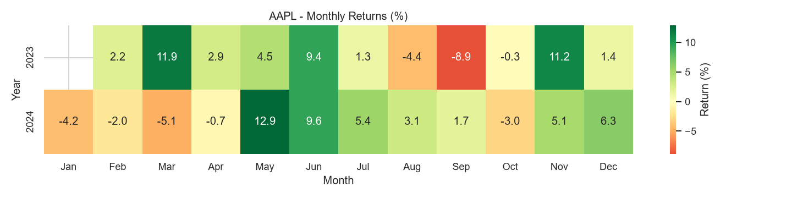

# Stock Analysis Report: AAPL

> This report is generated for EDUCATIONAL PURPOSES ONLY. It is NOT financial or investment advice. Past performance does not guarantee future results.

**Data source:** Yahoo Finance (yfinance)  
**Period:** 2023-01-03 to 2024-12-30 (501 trading days)

## 1. Price Summary
| Metric | Value |
|---|---|
| First close | 125.07 |
| Last close | 252.20 |
| Highest price | 260.10 (2024-12-26) |
| Lowest price | 124.17 (2023-01-03) |
| Average close | 189.83 |
| Average daily volume | 58,198,233 |

## 2. Return Analysis
| Metric | Value |
|---|---|
| Total return | 101.65% |
| CAGR (annualised growth) | 42.30% |
| Average daily return | 0.15% |
| Best day | 7.26% (2024-06-11) |
| Worst day | -4.82% (2024-08-05) |
| Positive days | 56.20% |

## 3. Risk Summary
| Metric | Value |
|---|---|
| Daily volatility | 1.35% |
| Annualised volatility | 21.37% |
| Risk level | Moderate |
| Sharpe ratio | 1.57 |
| Maximum drawdown | -16.71% (2024-04-19) |
| 1-day 95% VaR | -2.01% |

## 4. Trend & Signals
- **Current trend:** Strong Uptrend
- **Golden crosses:** 5  |  **Death crosses:** 4
- **Last signal:** Golden Cross (bullish) on 2024-12-03

## 5. Key Insights
- AAPL gained 101.65% over the period (2023-01-03 to 2024-12-30), a CAGR of 42.30%.
- Current trend based on 20/50-day moving averages: **Strong Uptrend**.
- Annualised volatility is 21.37%, which we classify as **Moderate** risk.
- The deepest fall from a peak (max drawdown) was -16.71% on 2024-04-19.
- On a typical bad day (95% VaR) the stock can drop about 2.01% or more, which happens on ~5% of days.
- The stock closed higher on 56.20% of trading days.
- Sharpe ratio of 1.57 is good - returns have compensated well for the risk taken.
- Last moving-average crossover signal: Golden Cross (bullish) on 2024-12-03.

## 6. Data Quality
- Rows loaded: 501, rows after cleaning: 501
- Duplicates removed: 0, missing values fixed: 0, invalid rows removed: 0

## 7. Charts
### Closing Price

### Moving Averages

### Daily Returns

### Return Distribution

### Volatility Drawdown

### Cumulative Return

### Monthly Heatmap

---
*This report is generated for EDUCATIONAL PURPOSES ONLY. It is NOT financial or investment advice. Past performance does not guarantee future results.*
