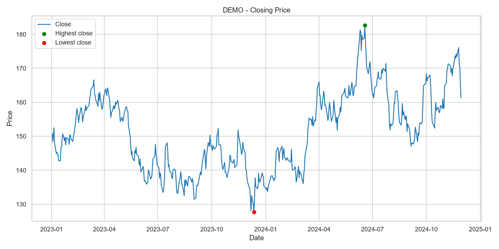
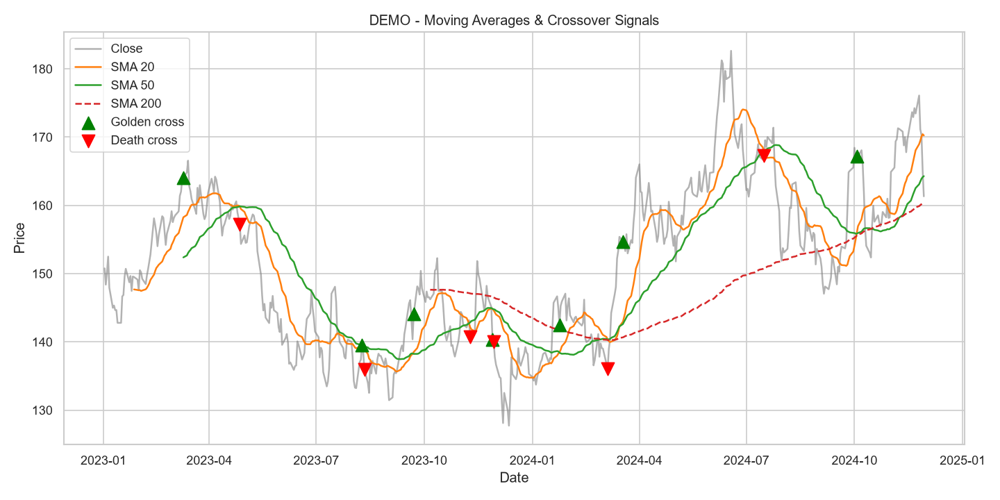
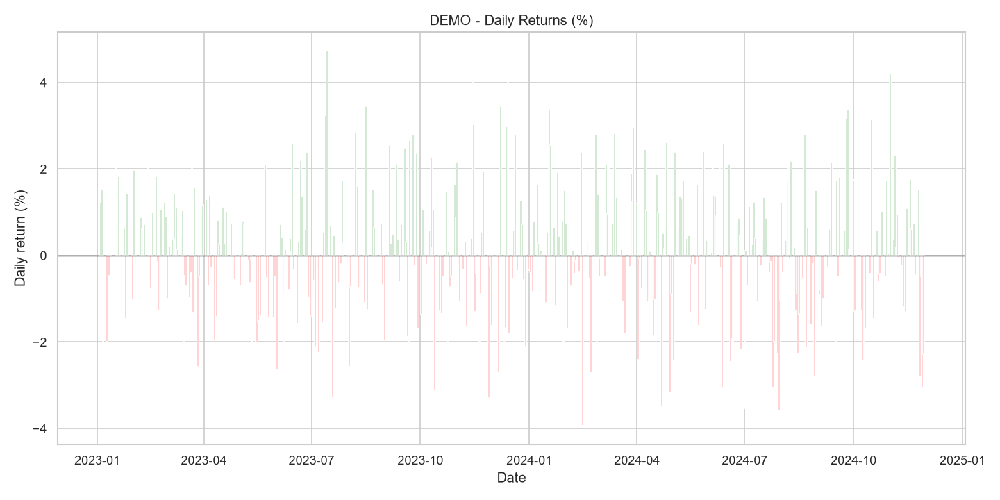
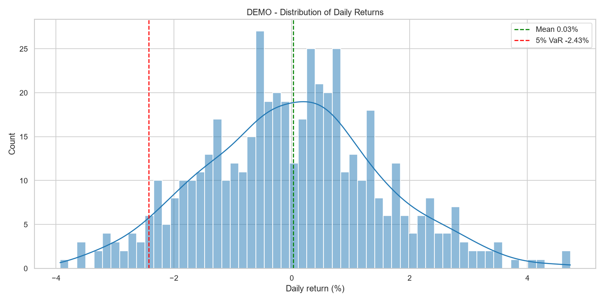
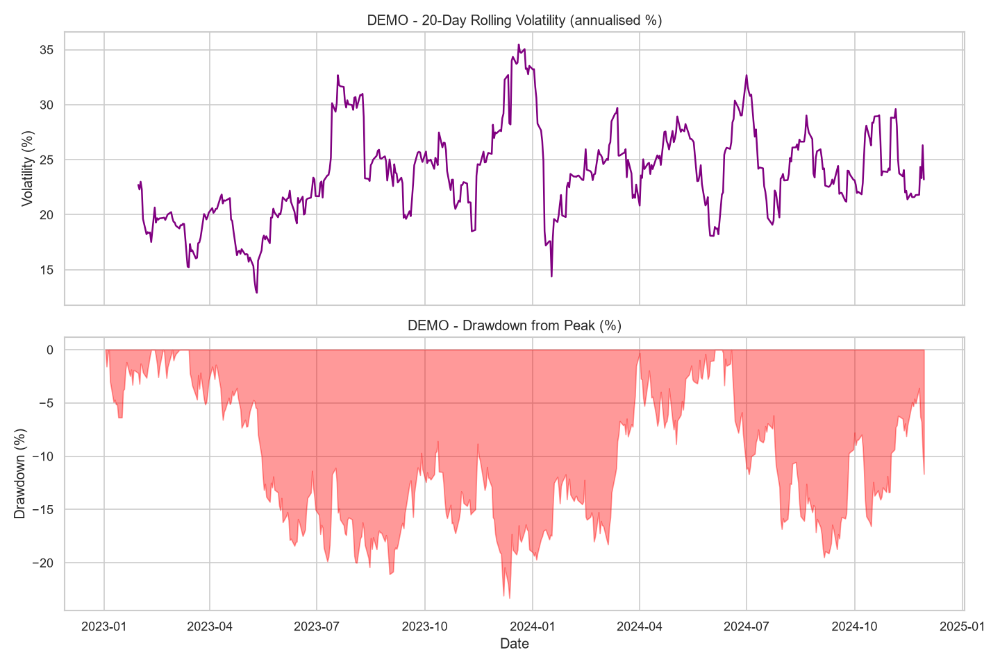
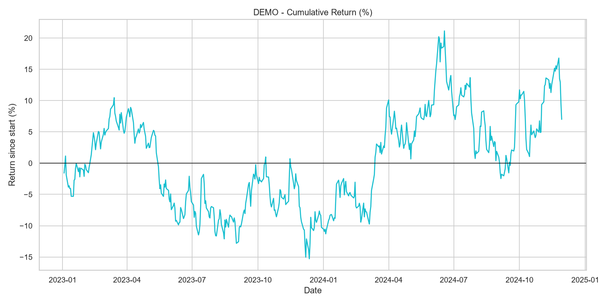
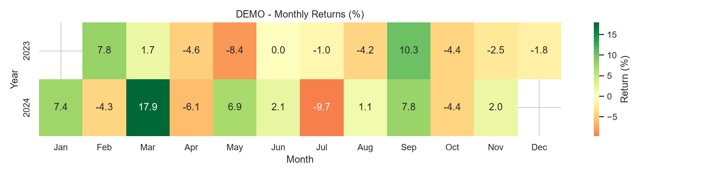

# Stock Analysis Report: DEMO

> This report is generated for EDUCATIONAL PURPOSES ONLY. It is NOT financial or investment advice. Past performance does not guarantee future results.

**Data source:** Bundled sample CSV (synthetic demo data)  
**Period:** 2023-01-02 to 2024-11-29 (500 trading days)

## 1. Price Summary
| Metric | Value |
|---|---|
| First close | 150.77 |
| Last close | 161.32 |
| Highest price | 185.79 (2024-06-18) |
| Lowest price | 127.09 (2023-12-07) |
| Average close | 151.40 |
| Average daily volume | 64,236,729 |

## 2. Return Analysis
| Metric | Value |
|---|---|
| Total return | 7.00% |
| CAGR (annualised growth) | 3.47% |
| Average daily return | 0.03% |
| Best day | 4.73% (2023-07-14) |
| Worst day | -3.93% (2024-02-15) |
| Positive days | 50.30% |

## 3. Risk Summary
| Metric | Value |
|---|---|
| Daily volatility | 1.52% |
| Annualised volatility | 24.08% |
| Risk level | Moderate |
| Sharpe ratio | 0.10 |
| Maximum drawdown | -23.31% (2023-12-12) |
| 1-day 95% VaR | -2.43% |

## 4. Trend & Signals
- **Current trend:** Uptrend (weakening)
- **Golden crosses:** 7  |  **Death crosses:** 6
- **Last signal:** Golden Cross (bullish) on 2024-10-03

## 5. Key Insights
- DEMO gained 7.00% over the period (2023-01-02 to 2024-11-29), a CAGR of 3.47%.
- Current trend based on 20/50-day moving averages: **Uptrend (weakening)**.
- Annualised volatility is 24.08%, which we classify as **Moderate** risk.
- The deepest fall from a peak (max drawdown) was -23.31% on 2023-12-12.
- On a typical bad day (95% VaR) the stock can drop about 2.43% or more, which happens on ~5% of days.
- The stock closed higher on 50.30% of trading days.
- Sharpe ratio of 0.10 is modest - returns only slightly beat the risk-free rate for the risk taken.
- Last moving-average crossover signal: Golden Cross (bullish) on 2024-10-03.

## 6. Data Quality
- Rows loaded: 501, rows after cleaning: 500
- Duplicates removed: 1, missing values fixed: 2, invalid rows removed: 0

## 7. Charts
### Closing Price

### Moving Averages

### Daily Returns

### Return Distribution

### Volatility Drawdown

### Cumulative Return

### Monthly Heatmap

---
*This report is generated for EDUCATIONAL PURPOSES ONLY. It is NOT financial or investment advice. Past performance does not guarantee future results.*
